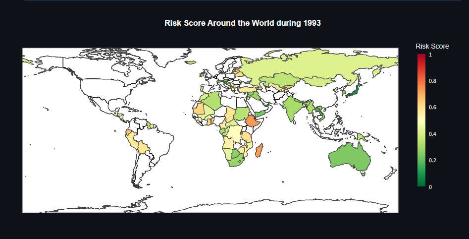
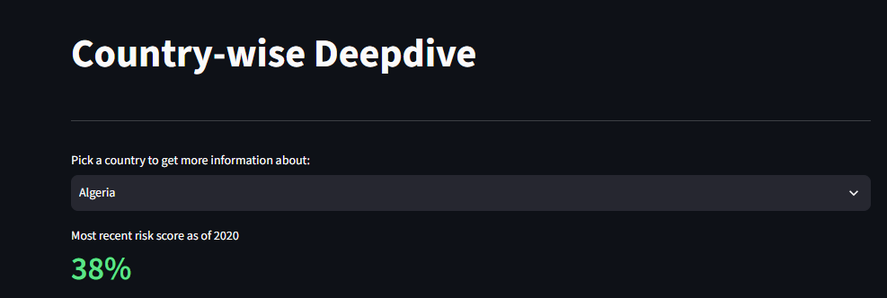

# Global Inequality Early Warning System

A machine learning project that estimates which countries are at risk of a **spike in income inequality** (measured by the Gini index) within the next three years, using World Bank indicators. Results are explored in an interactive Streamlit dashboard.

**Live demo:** [add your Streamlit Community Cloud link]



<!-- Add a screenshot of the world map page. A second one of the country deep-dive page is a nice touch. -->

---

## Summary

- **Question:** Can a country's recent economic indicators give an early signal that its Gini index is about to rise sharply?
- **Data:** 15 World Bank indicators for 158 countries, 1990 to 2020 (4,898 country-years).
- **Target:** a *spike* is a country-year in which Gini rises by more than **1.8 points** above its current value in at least one of the next **three** years.
- **Models:** a logistic regression baseline and a tuned XGBoost classifier, evaluated on a time-based holdout (2012 to 2020).
- **Result:** a modest signal. XGBoost reached AUC 0.64 but did not clearly beat the baseline (see below). The project is exploratory and is not meant for policy decisions.

## Results

Test set: 2012 to 2020 (824 country-years). About 24% of test rows are spikes, so a model that guessed at random would reach roughly 24% precision.

| Model | Precision | Recall | F1 | ROC AUC |
|---|---|---|---|---|
| Logistic regression (baseline) | 0.32 | 0.64 | 0.43 | 0.67 |
| XGBoost (tuned) | 0.32 | 0.55 | 0.41 | 0.64 |

Both models reach about 1.3 times the random precision. XGBoost was tuned to maximise recall, and on these metrics it performs about the same as the baseline. The risk scores are **not calibrated probabilities**: the model weights spikes more heavily during training (`scale_pos_weight`), so scores run higher than the real spike rate. Use them to compare countries with each other, not as exact chances.

## What the model uses (SHAP)

Mean absolute SHAP values show how much each feature moves the model's predictions:

| Feature | Mean \|SHAP\| |
|---|---|
| One-year change in Gini (`DifferenceIn_SI.POV.GINI`) | 0.26 |
| Region | 0.26 |
| `NE.CON.PRVT.PC.KD` | 0.17 |
| `NY.GDP.PCAP.KD` (GDP per capita) | 0.16 |
| Inflation, 3-year lag (`FP.CPI.TOTL.ZG_Lag-3`) | 0.13 |
| `NE.TRD.GNFS.ZS` (trade, % of GDP) | 0.12 |
| 27 other features (combined) | 0.58 |

Predictions draw on many indicators, and no single one dominates.

**Direction of the Gini change.** A rise in Gini over the previous year is associated with *higher* predicted risk, while small to moderate declines are associated with *lower* risk. Very large declines show a weaker effect. These are associations inside the model, not causal claims.

**Regional averages (test period).**

| Region | Rows | Mean predicted risk | Actual spike rate |
|---|---|---|---|
| Latin America & Caribbean | 130 | 0.55 | 0.32 |
| Sub-Saharan Africa | 167 | 0.52 | 0.24 |
| Europe & Central Asia | 345 | 0.43 | 0.19 |
| East Asia & Pacific | 94 | 0.30 | 0.32 |
| South Asia | 21 | 0.30 | 0.24 |
| Middle East, North Africa, Afghanistan & Pakistan | 51 | 0.27 | 0.18 |
| North America | 16 | 0.14 | 0.12 |

The model ranks Latin America & Caribbean and Sub-Saharan Africa highest, but observed spike rates support this only partly: Latin America & Caribbean (32%) was among the highest, while Sub-Saharan Africa (24%) was close to the overall average. South Asia and North America have too few rows to draw conclusions.

## How it works

1. **Collect:** download 15 indicators through the `wbdata` library (`datasets.ipynb`).
2. **Clean:** drop countries with no Gini values or with more than half of their indicator values missing. Linearly interpolate Gini across gaps of up to three years, and flag which values are original versus interpolated. Fill other indicators with limited forward-fill and interpolation, then each country's median (`cleaning2.ipynb`).
3. **Engineer features:** one- to three-year lags and one-year changes for five indicators (Gini, GDP growth, youth unemployment, inflation, government expense), plus the World Bank region (`FeatureEngineering.ipynb`).
4. **Explore:** distributions, spikes by region and decade, and event studies around spike years (`eda.ipynb`, `edatwo.ipynb`).
5. **Model:** a time-ordered split (about 1990 to 2011 for training, 2012 to 2020 for testing, no shuffling). Logistic regression baseline, then XGBoost inside a scikit-learn `Pipeline` (imputer, scaler, classifier) tuned with `GridSearchCV` (`ModelTraining.ipynb`).
6. **Explain:** SHAP values for global and per-country explanations (`ShapValues.ipynb`).
7. **Serve:** precomputed scores and SHAP values are loaded by the Streamlit app, so the model is not retrained or run on the server.

## The dashboard

- **Home:** background on the Gini index, the spike definition, methodology and key findings.
- **World Map:** a choropleth of modelled risk for any year from the slider, plus a table of the highest-scoring countries.
- **Country Deep-dive:** the latest score for a chosen country, a SHAP waterfall chart of the indicators driving it, and its Gini history (blue points are observed, red points are interpolated).

## Limitations

- **Missing data.** Gini is recorded for only about 62% of country-years, and about 35% of those values are interpolated. Spike labels are built partly from interpolated values.
- **Estimate rows in the dashboard.** The dashboard shows scores for country-years that have no label (2,113 rows). Of these, 1,880 (about 89%) have no recorded Gini. Those scores come from other indicators plus median-filled values and should be read as estimates, not forecasts. 
- **Modest predictive power.** AUC of 0.64, with XGBoost roughly matching logistic regression.
- **Scores are not probabilities** (see above).
- **Evaluation caveats.** Hyperparameter tuning used cross-validation that is not time-ordered and optimised recall only. Labels look three years ahead, so the last training years overlap the test period. Each country's median fill uses all years, including the test period.
- **Region is a feature.** Part of the regional pattern reflects spike rates the model learned during training.
- **Interpretation.** SHAP shows how the model uses features, not what causes inequality.

## Future work

- Separate estimate rows from rows with a recorded Gini on the map, or exclude them.
- Use time-ordered cross-validation and a metric other than recall alone.
- Calibrate the scores so they can be read as probabilities.
- Show scores for 2012 to 2020 for countries with known outcomes, since those are the only truly out-of-sample predictions.
- Improve the website structure and add more to it.

## Repository structure

```text
├──dashboard
│    ├── app.py                      # Streamlit home page
│    ├── pages/
│    │   ├── 01_World_Map.py
│    │   └── 02_Country_Deepdive.py
│    ├── utils.py                    # cached data loaders
│    ├── assets/                     # precomputed scores, SHAP values, data, images
│
├── notebooks/
│   ├── datasets.ipynb
│   ├── cleaning2.ipynb
│   ├── FeatureEngineering.ipynb
│   ├── eda.ipynb
│   ├── edatwo.ipynb
│   ├── ModelTraining.ipynb
│   └── ShapValues.ipynb
├── requirements.txt
├── README.md
└── XandYDataframes                 # Dataframes used in training and assessment
```

## Run it locally

```bash
git clone https://github.com/meltingicecube06/Inequality-Spikes-Predictor.git
cd InequalitySpikesWarningSys
python -m venv venv
# Windows: venv\Scripts\activate    macOS/Linux: source venv/bin/activate
pip install -r requirements.txt
cd dashboard
streamlit run app.py
```

Developed with Python 3.11. The notebooks expect the data files in the working folder and use Windows-style paths in places, so adjust paths if you rerun them. 

## Data and credits

- Indicators: World Bank World Development Indicators, accessed with the `wbdata` library.
- Regions: World Bank country classification (`CLASS_2025_10_07.xlsx`).
- Gini diagram: [Gini Coefficient Calculation by researchgate (via WikiMedia Commons) / CC BY-SA 4.0](https://www.researchgate.net/figure/Lorenz-curve-The-Gini-index-is-calculated-as-the-ratio-of-the-area-between-the-perfect_fig1_341916065).

## Author

Arnav Rajesh Nair, University of Alberta (Computer Science, Economics minor).
[LinkedIn link](https://www.linkedin.com/in/arnavrajeshnair/) | arnavrajeshnair@gmail.com